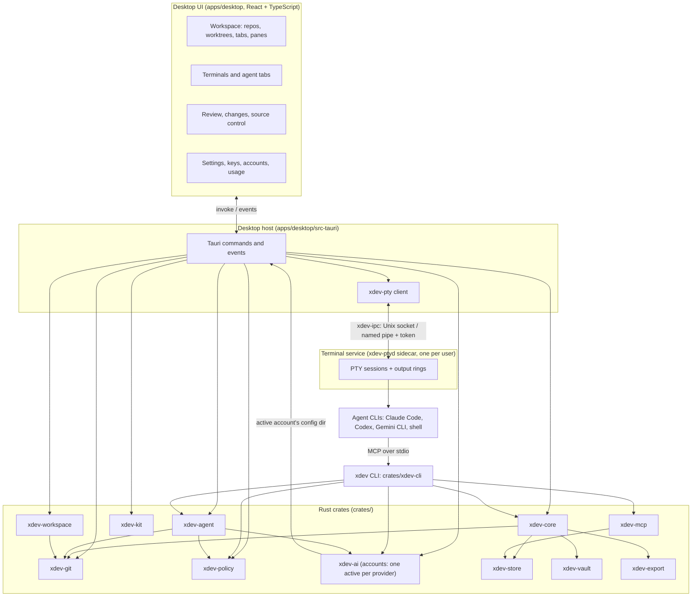

# Architecture

xDev is a local-first agentic IDE. It is one desktop app (Tauri 2, Rust and React) and one CLI (`xdev`), built on a set of Rust crates. Everything runs on your machine. Agents run as their real CLI (Claude Code, Codex, Gemini CLI and others) in embedded terminals, each in its own git worktree.

This page is the map. The decisions behind it are in [`docs/adr`](adr/).

## The pieces

| Crate | What it does |
|---|---|
| `xdev-workspace` | The list of repos and the worktrees made from them. |
| `xdev-automations` | Scheduled agent runs: the model, cron and RRULE schedules in the automation's time zone, the JSON store, the tick decision, the extra-args allowlist and the precheck runner. The app starts the runs in terminal tabs. |
| `xdev-pty` | Terminals: a shell or an agent CLI in a pseudo console. Holds the `xdev-ptyd` service (`service.rs`), the app's client for it (`client.rs`) and the output pump (`pump.rs`). Output goes to a ring first, is batched for the UI and paused when the UI falls behind. |
| `xdev-ipc` | A per-user local endpoint between xDev's own processes: a Unix socket on macOS and Linux, a named pipe on Windows, with a token file that proves the peer is the same user. |
| `xdev-agent` | Agent tasks: a goal worked on in its own worktree, with evidence kept and nothing merged until a person approves. Squads: one agent per seat on one task. |
| `xdev-kit` | Reads agent homes on this machine: skills, memory files and CLI session logs (token usage comes from here). |
| `xdev-git` | Runs `git`: status, diffs, history, commit, restore. |
| `xdev-core` | Domain model and use cases. Free of Tauri, so the CLI and the app share it. |
| `xdev-policy` | What xDev may do for you. The app checks it, not a prompt, so an agent cannot talk its way past it. |
| `xdev-ai` | AI providers: API key, CLI subprocess and Ollama (local models, embeddings). Agent accounts live here (`accounts.rs`): one active account per provider. |
| `xdev-vault` | Markdown files: frontmatter, content hashes, file watching. |
| `xdev-store` | SQLite index: metadata, FTS5 full-text search and sqlite-vec vectors. |
| `xdev-export` | Writes agent context files: `AGENTS.md`, `CLAUDE.md`, `GEMINI.md`, Cursor rules. |
| `xdev-mcp` | MCP server over stdio: `context_pack`, `search_docs`, `get_doc`, `list_docs`, `stale_docs`, `propose_update`. |
| `xdev-api` | Versioned WIT world for apps and plugins (deferred, see ADR 0001). |
| `xdev-cli` | The `xdev` command: context, MCP, tasks, squads, accounts, agent hooks. |

## How an agent tab runs

1. You pick a repo and a branch. `xdev-workspace` creates a git worktree for it and runs the repo's setup script if there is one.
2. You open an agent tab. The app asks the terminal service (`xdev-ptyd`) to start the agent CLI (for example `claude` or `codex`) in a pseudo console inside that worktree, with the active account's config dir for that provider and the launch options you chose (ADR 0013). The tab keeps its `accountSource`.
3. The agent reads project context through `xdev mcp` and the exported rule files, so it asks for ranked doc chunks instead of reading whole folders (ADR 0002).
4. Agent hooks report status (working, waiting for input, done) back to the app. The tab, the sidebar and notifications show it.
5. You review the diff per file, leave review notes, commit, and open a pull request. Nothing reaches your main branch without your review (ADR 0003, ADR 0004).
6. Stopping a tab stops the whole process tree (ADR 0006).

## Terminal service and session lifetime

Terminal sessions do not live in the app. `xdev-ptyd` is a separate per-user process, shipped as a Tauri sidecar (`tauri.ptyd.conf.json`, built by `scripts/ptyd-sidecar.mjs`). The app starts it if nothing answers, and talks to it over `xdev-ipc`. The service keeps its token, `sessions.json` and (off Windows) its socket in a `ptyd` folder under the local data dir.

- Each PTY's output goes to a ring in the service, then to the one attached client. A client that leaves too many bytes unacked stops getting output (the ring keeps it); after a while it is detached, and the child keeps running.
- Quit, reload, update or crash of the UI does not end a session. On start, the UI restores its layout and re-attaches tabs whose PTY still runs (`terminal/ptyClient.ts`, `workspace/sessions.ts`), replaying output from the last seq it drew. Tabs whose PTY is gone fall back to resume.
- A debug build and a release build use different endpoint names, so they never meet each other's service.

## Agent accounts

An agent account is a config dir for a provider's CLI. There is one active account per provider (`Registry.active`, `activate()` in `xdev-ai`); none means the CLI's own home. New agent tabs launch with the active account's config dir, and each tab keeps its `accountSource`. When the active account changes, running tabs are handled by the setting `agents.accountSwitch`: `ask` (a dialog lists the tabs), `restart` or `keep`. `carry_session()` copies a session log from one account's home to another's, so a restarted tab can resume; it never moves or overwrites a log.

## Where data lives

| Data | Where | Why |
|---|---|---|
| Your docs and code | Your repo, as plain files | Files are the source of truth (ADR 0002). |
| Search and vector index | SQLite in the vault | Rebuilt from files at any time. |
| Settings, repos, profiles | Data folder (`%APPDATA%\asia.xdev.desktop` on Windows) | Records that may roam (ADR 0012). |
| Terminal service files (token, `sessions.json`, socket) | `ptyd` under the local folder | Bound to this machine and user. |
| Terminals, layouts, caches | Local folder (`%LOCALAPPDATA%\asia.xdev.desktop` on Windows) | Bound to this machine (ADR 0012). |
| Agent sessions and usage | The agent CLIs' own homes (`~/.claude`, `~/.codex`) | Read only; xDev does not copy them. |

## Security model

- Trust tiers for code that runs in the app (ADR 0001): the shell, signed app packs, sandboxed plugins.
- Policy is enforced in Rust, and you own it (ADR 0004).
- Updates are signed with a key the owner holds (ADR 0005). Packs and the registry index are signed with ed25519 (ADR 0010).
- The terminal service is local only: a Unix socket or a named pipe, no network port. A token file (random, written after the endpoint is bound; mode 0600 in a 0700 folder on Unix) proves the peer is the same user, and a wrong token ends the connection before any other frame is read.
- Plugin UI runs in an opaque-origin iframe and talks only by `postMessage` (ADR 0008).

## Frontend

`apps/desktop/src` is grouped by feature: `workspace`, `terminal`, `agents`, `agentSessions`, `review`, `changes`, `files`, `doc`, `search`, `palette`, `keys`, `settings`, `status`, `kit`, `issues`, `quickCommands`. Each `mock*.ts` file mirrors a Tauri command group so the UI runs and is tested in a browser without the Rust host. TypeScript types for commands come from Rust (`packages/bindings`).

## Decisions

| ADR | Decision |
|---|---|
| [0001](adr/0001-app-runtime.md) | App runtime: three trust tiers |
| [0002](adr/0002-context-graph.md) | Context graph in SQLite, files as the source |
| [0003](adr/0003-agent-execution.md) | Agent execution: tasks on worktrees, runners behind a trait |
| [0004](adr/0004-policy-and-security.md) | Policy enforced by the app, owned by the person |
| [0005](adr/0005-release-signing-and-updates.md) | Signed updates; OS code signing later |
| [0006](adr/0006-process-supervision.md) | Process supervision: stop the whole tree |
| [0007](adr/0007-xdev-api-wit-world.md) | One versioned WIT world, `xdev:api@1` |
| [0008](adr/0008-plugin-ui-isolation.md) | Plugin UI in an opaque-origin iframe |
| [0009](adr/0009-app-capabilities-and-manifest.md) | App capabilities declared in the manifest |
| [0010](adr/0010-package-trust-chain.md) | Packs and registry signed with ed25519 |
| [0011](adr/0011-event-bus-contract.md) | Events: named topics, at-most-once, bounded queues |
| [0012](adr/0012-local-and-roaming-data.md) | Machine-bound data local, records in the data folder |
| [0013](adr/0013-agents-in-pty-terminals.md) | Agents run as their real CLI in PTY terminals |
